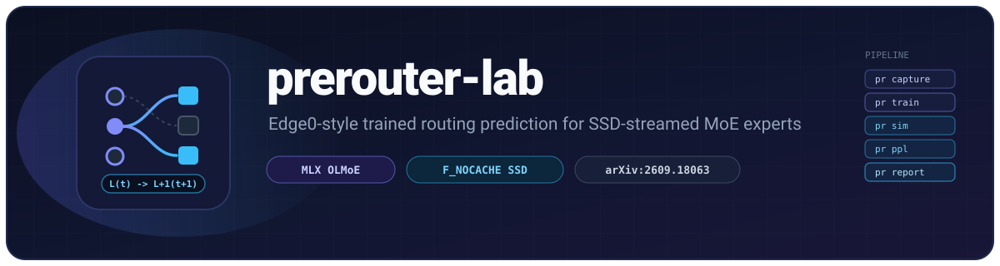
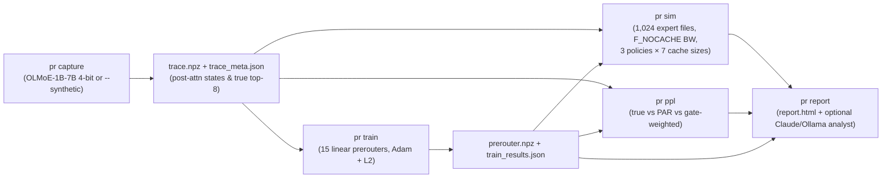

<p align="center">
  
</p>

<p align="center">
  <a href="https://www.python.org/downloads/"></a>
  <a href="https://arxiv.org/abs/2609.18063"></a>
  
  <a href="https://github.com/aayushhzz/prerouter-lab/stargazers"></a>
  <a href="https://github.com/aayushhzz/prerouter-lab/issues"></a>
</p>

<p align="center">
  <a href="#pipeline-architecture">Architecture</a> •
  <a href="#quick-start">Quick Start</a> •
  <a href="#cli-reference">CLI Reference</a> •
  <a href="#demo-results">Demo Results</a> •
  <a href="#limits">Limits</a> •
  <a href="PAPER_NOTES.md">Paper Notes</a> •
  <a href="docs/architecture.md">Architecture Docs</a>
</p>

---

**`prerouter-lab`** is a small, measurable replication of the core idea in **"The Other Half of the Memory Wall: Serving 35B MoEs from SSD with Trained Routing Prediction"** (Edge0, [arXiv:2609.18063](https://arxiv.org/abs/2609.18063), official code at [Edge0-AI/edge0](https://github.com/Edge0-AI/edge0); this repo is an independent implementation and copies no code from it). It runs on a 16 GB Apple Silicon Mac with a real 4-bit MoE (`mlx-community/OLMoE-1B-7B-0125-Instruct-4bit`).

## What the Paper Says and Why It Matters

Mixture-of-experts sparsity cuts the compute per token, not the bytes you have to store. A 35B-class MoE is about 19.5 GB at 4-bit, so on a laptop it either doesn't fit or crowds out everything else. Edge0 leaves the experts on the SSD and streams them in. A naive version stalls on every layer because layer `N+1`'s experts are only known once layer `N` finishes. Edge0 trains a tiny per-layer **prerouter** that predicts layer `N+1`'s top-k **one token ahead** from layer `N`'s state, overlapping SSD reads with compute.

The key twist: **the prediction is used as the routing**. The staged experts are then exactly the routed experts, so no read is wasted and nothing is dropped, shifting the quality cost into training (an unmerged recovery LoRA). The paper reports a 35B MoE at ~20 tok/s inside 3 GiB of active memory, and +80–84% decode speedup on a 16 GB machine.

See [PAPER_NOTES.md](PAPER_NOTES.md) for the full concept-to-code mapping and list of simplifications, and [docs/architecture.md](docs/architecture.md) for module-level design details.

## Pipeline Architecture



## Quick Start

### Installation

```bash
git clone https://github.com/aayushhzz/prerouter-lab.git
cd prerouter-lab

python3 -m venv .venv                      # Python >=3.9 (tested on 3.9.6)
.venv/bin/pip install -e '.[test]'         # numpy, mlx-lm (pulls mlx), pytest
```

The first `pr capture` downloads the 3.9 GB checkpoint into the Hugging Face cache (pass `--synthetic` to skip model download and run on synthetic Zipf + locality traces).

### Run the Full Pipeline

```bash
source .venv/bin/activate
pr capture            # ~20–30 s once cached; logs per-layer router inputs and true top-8
pr train              # ~25 s (numpy, 15 heads)
pr sim                # writes data/experts (3.4 GB, once), measures SSD, replays 3 policies × 7 caches
pr ppl                # ~2 min: 3 routing modes over the held-out docs
pr report             # writes report.html (+ optional analyst summary)
python -m pytest -q   # offline tests (fake backend, synthetic traces)
```

Use `--data DIR` before the subcommand to work in another directory. Run `rm -rf data/experts` to reclaim the 3.4 GB of expert files.

## CLI Reference

Entrypoint `pr` ([prerouter_lab/cli.py](prerouter_lab/cli.py)):

| Command | Key Options | What It Does |
|---|---|---|
| `pr capture` | `--model`, `--synthetic`, `--max-tokens` (default `3200`) | Runs the MLX MoE layer-by-layer over ~3.2k tokens of agent transcripts and CPython stdlib code, logging router inputs, true top-8, and resident decode speed. Falls back to synthetic Zipf + locality traces on load failure or `--synthetic`. |
| `pr train` | `--steps` (`600`), `--lr` (`3e-3`), `--l2` (`1e-2`) | Fits 15 per-layer linear prerouters (`L(t) -> L+1(t+1)`) in NumPy, warm-started from layer `L+1`'s router weights. Reports held-out recall@8 vs previous-token, most-frequent, and next-router zero-shot baselines. |
| `pr sim` | `--experts-dir`, `--n-read` (`96`) | Writes each of the 1,024 experts' int4 weights to its own file (3.54 MB each, 3.4 GB total), measures `F_NOCACHE` SSD bandwidth, and replays the held-out trace across 7 cache sizes under **on-demand LRU**, **LRU + predicted prefetch**, and **prediction-as-routing (Edge0)**. |
| `pr ppl` | *(none)* | Computes held-out perplexity with the true router, pure prediction-as-routing, and prerouter-selected experts weighted by the layer's own gate. |
| `pr report` | `--out` (`report.html`), `--backend` (`claude\|ollama\|fake\|none`), `--llm-model`, `--refresh` | Builds `report.html` (inline SVG curves, recall/sim/SSD/PPL tables, light & dark modes) with an optional schema-checked analyst summary cached in `data/analysis.json`. |

### Analyst Backends

The research pipeline (`capture`, `train`, `sim`, `ppl`) is plain NumPy and MLX and needs no LLM. Only `pr report` optionally calls an analyst agent via [prerouter_lab/backend.py](prerouter_lab/backend.py):

- `claude` *(default)*: invokes `claude -p --output-format json --json-schema ... --tools ""` using your local Claude Code login (`ANTHROPIC_API_KEY` is stripped from the child environment).
- `ollama`: optional local fallback (`--backend ollama --llm-model qwen3:4b-instruct`).
- `fake`: used by offline tests. `none`: skips the analyst section.

Answers are content-hash cached in `data/analysis.json` (`--refresh` forces a new call).

> **Note:** The local Claude Code CLI setup is intended for personal local use. Sharing or deploying it to other users requires switching to API-key authentication per Anthropic's terms.

## Demo Results

Real run on **M2 Pro 16 GB** with `OLMoE-1B-7B-0125-Instruct-4bit` (3,200 tokens across 9 docs: 2,304 train / 896 held-out):

### Prerouter Recall@8 (mean over 15 heads, 893 held-out pairs)

| Predictor | Held-Out Recall@8 |
|---|---|
| **Linear prerouter** | **0.647** *(train 0.874)* |
| Most-frequent experts | 0.491 |
| Previous token's experts | 0.477 |
| Next layer's router (zero-shot) | 0.462 |

- **SSD:** 96 expert files, **3,979 MB/s** at QD1 with `F_NOCACHE` (**0.89 ms** per 3.54 MB expert).
- **Compute:** measured resident decode was **39.4 ms/token** in this run (16–39 ms/token across runs under swap pressure).

### Cache Simulation (`pr sim`, 896 held-out tokens; 4 of 7 cache sizes)

```text
policy                          cache RAM GiB   MB/token  stall ms   tok/s  wasted
On-demand LRU                     128    0.67      302.1      75.9     8.7       0
LRU + predicted prefetch          128    0.67      539.2      97.5     7.3   21873
Prediction-as-routing (Edge0)     128    0.67      447.1      75.7     8.7       0
On-demand LRU                     256    1.09      169.6      42.6    12.2       0
LRU + predicted prefetch          256    1.09      229.0      33.6    13.7   12912
Prediction-as-routing (Edge0)     256    1.09      122.3       7.5    21.3       0
On-demand LRU                     512    1.94       68.0      17.1    17.7       0
LRU + predicted prefetch          512    1.94       85.3      13.9    18.7    4148
Prediction-as-routing (Edge0)     512    1.94       31.6       1.3    24.6       0
On-demand LRU                    1024    3.63        4.0       1.0    24.7       0
LRU + predicted prefetch         1024    3.63        4.0       0.7    24.9     127
Prediction-as-routing (Edge0)    1024    3.63        3.7       0.2    25.2       0
distinct experts per predicted layer: true 62.9, predicted 57.2; adjacent-token overlap: true 0.46, predicted 0.59
```

### Perplexity (`pr ppl`, 3 held-out docs, 893 predicted tokens, no recovery LoRA)

| Routing Mode | Perplexity | Change |
|---|---|---|
| True router | **8.55** | baseline |
| Prediction-as-routing (prerouter picks experts **and** weights) | 153.5 | +1695% |
| Prerouter picks experts, layer's own gate weights them | **19.28** | +125% |

**Key takeaways:**
- **Zero wasted reads under prediction-as-routing** (verified in [tests/test_sim.py](tests/test_sim.py)), whereas predicted prefetch with true routing wastes thousands of reads and slows down tight caches.
- **Smoother routing drives most of the cache win** (59% adjacent-token overlap vs 46% true, touching fewer distinct experts), which is also why perplexity rises without Edge0's recovery LoRA.

## Limits

- **Throughput is modeled, not streamed.** No streaming executor exists here; tok/s is modeled from `compute_ms + stall` using measured QD1 SSD bandwidth and resident compute time.
- **Small scale & mild overfitting.** 1B active / 7B total, ~3.2k captured tokens (train 0.87 vs held-out 0.65 recall).
- **Hidden-state drift.** `pr sim` replays features captured under true routing; `pr ppl` does model student-path drift by feeding each head its own states.
- **No recovery LoRA.** Perplexity numbers represent the raw upper-bound cost of routing replacement before recovery training.
- **Synthetic fallback.** `pr capture --synthetic` uses a planted Zipf + locality trace; `report.html` displays a warning banner and `pr ppl` skips it.

## Project Structure

```text
prerouter-lab/
├── assets/
│   └── banner.svg             # Repository hero banner
├── docs/
│   └── architecture.md        # Prerouter math, cache simulator, and SSD benchmark notes
├── prerouter_lab/
│   ├── cli.py                 # `pr` CLI: capture | train | sim | ppl | report
│   ├── mlx_model.py           # Layer-by-layer OLMoE forward with logging & replaceable routing
│   ├── capture.py             # Corpus loader, trace capture, and synthetic fallback
│   ├── trace.py               # Trace container, doc-boundary split, Zipf + locality generator
│   ├── prerouter.py           # Feature builder, Adam linear heads, recall@k & baselines
│   ├── ssd.py                 # Per-expert file writer and F_NOCACHE bandwidth benchmark
│   ├── sim.py                 # Expert cache simulator across 3 policies × 7 RAM budgets
│   ├── ppl.py                 # Held-out perplexity under 3 routing modes
│   ├── report.py              # Standalone HTML report generator (inline SVG, light/dark)
│   ├── backend.py             # Claude CLI / Ollama / fake analyst backends
│   └── corpus/                # Agent transcript fixtures
├── tests/                     # Offline pytest suite (no LLM calls, no model download)
├── paper/edge0.pdf            # Reference paper
├── PAPER_NOTES.md             # Concept-to-code mapping and simplifications
├── pyproject.toml
└── README.md
```

---

<p align="center">
  Built by <a href="https://github.com/aayushhzz">aayushhzz</a> •
  <a href="https://github.com/aayushhzz/prerouter-lab/issues">Report an Issue</a> •
  <a href="https://github.com/aayushhzz">More Projects</a>
</p>
